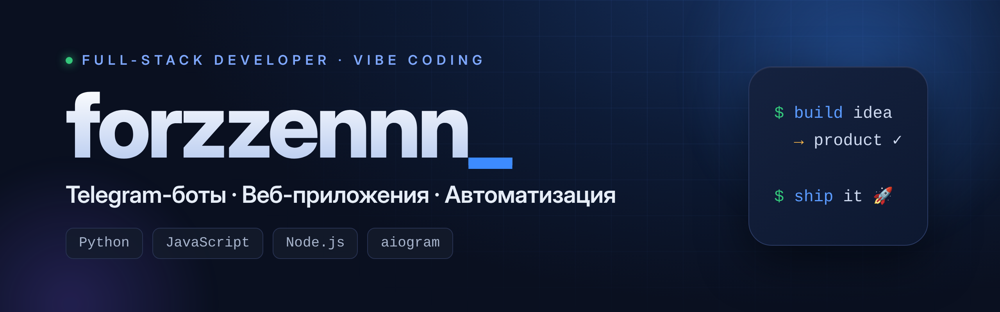

  

<h1 align="center">forzzennn</h1>

  <b>Full-stack developer</b> · Python &amp; JavaScript · Vibe coding 
  Telegram bots · Web apps · Scripts &amp; automation

  
  
  
  
  
  

---

## About me

Learning Python and JavaScript, into vibe coding — I turn an idea into a working product fast. I build Telegram bots, web apps and task-specific scripts, from the first line of code to launch.

## What I do

- **Telegram bots** — moderation, broadcasts, lead capture, Mini Apps inside Telegram
- **Web apps** — Node.js backend, databases, realtime, admin panels
- **Websites & landing pages** — mobile-responsive layouts, forms, wired to a backend
- **Scripts & automation** — parsing, data processing, bots, routine automation

## Projects

- 💱 **MAO Exchange** — crypto exchange with P2P: secure escrow deals, real-time chat, 2FA and an admin panel · `Node.js · Express · Socket.io · SQLite`
- 🏙 **Oko** — Telegram bot for a real-estate channel: collects posts, strips ads and links, publishes in one click + Mini App · `Python · aiogram · Telethon`
- 🌐 **Websites & landing pages** — single-page sites, responsive, with working forms

## Find me

  
  

